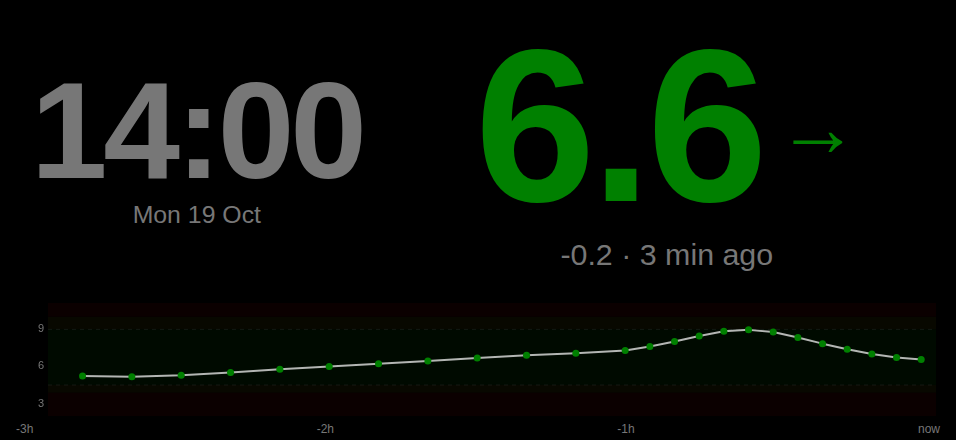
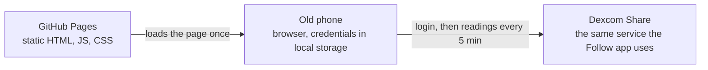
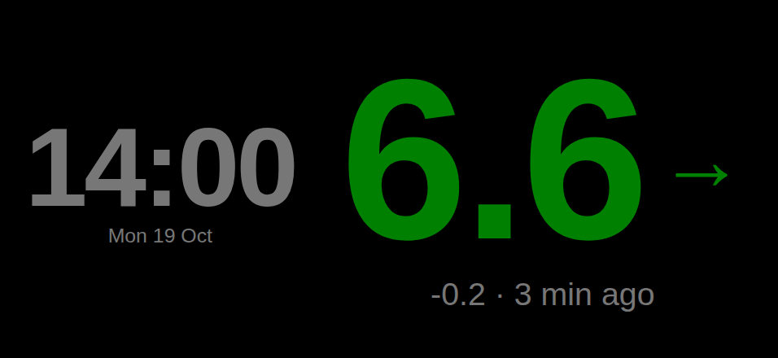
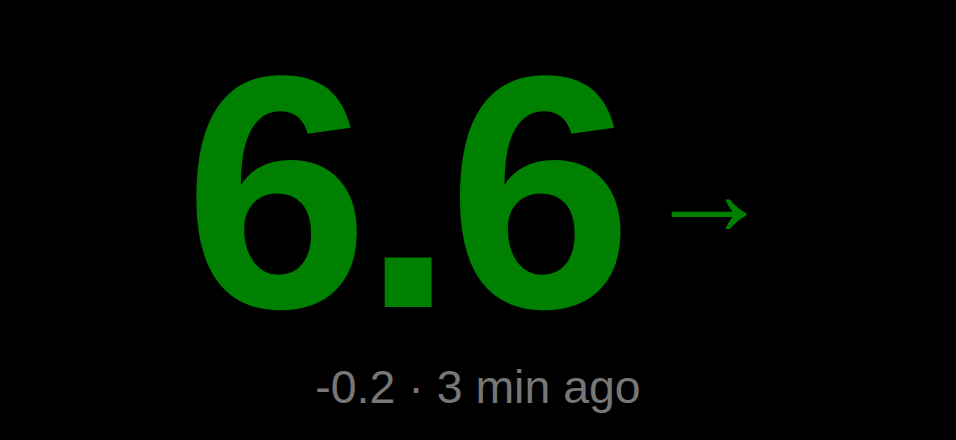

# CGM Dashboard

Turn an old phone into a live Dexcom glucose display. Free, no server,
ten-minute setup.





It is a single static web page. Your phone's browser logs in to
Dexcom's Share service directly, the same service the Dexcom Follow app
uses. Your username and password stay on the phone and are sent only to
Dexcom. Nothing is stored on GitHub or anywhere else.

> **Not a medical device.** This is a convenience display with no
> alarms. Keep using the Dexcom app and its alerts. It relies on
> Dexcom's unofficial Share interface, which Dexcom can change or
> switch off at any time without notice.

## You need

1. A **Dexcom account**, the one you use in the Dexcom mobile app.
2. **Sharing turned on** in the Dexcom app with at least one follower.
   Dexcom only serves live readings for accounts that share. A second
   email address you own works as the follower. In the Dexcom G6/G7
   app: `Connections → Share`.
3. A **GitHub account** (free).

## Set up

1. Click **Fork** at the top of this page, keep the name
   `cgm-dashboard`, create the fork.
2. In your fork open **Settings → Pages**. Under *Build and
   deployment* choose **Deploy from a branch**, branch `main`, folder
   `/ (root)`, then **Save**.
3. Wait a minute, reload the Pages settings, and open the URL it shows:
   `https://<your-github-name>.github.io/cgm-dashboard/`
4. Open that URL on the phone. Enter the Dexcom username, password and
   region (**OUS** for everyone outside the US and Japan). Tap
   **Connect**.
5. Readings appear within a few seconds. On Android, tap once to go
   fullscreen. iPhones don't allow fullscreen web pages; use *Add to
   Home Screen* (below) instead.

## Using it

- **Stand the phone in landscape.** The layouts are designed and tested
  for landscape phones and tablets. Portrait still works but is not
  tuned.
- **Swipe left or right** (or press the arrow keys) to switch layouts:

  | Full | Compact | Focus |
  |---|---|---|
  |  |  |  |
  | Clock, reading, 3-hour graph | Clock and reading | Reading, change and age, as large as the screen allows |

- **Double-tap the top-left corner** to forget the credentials and go
  back to setup.
- Between **22:00 and 07:00** the screen dims.
- Dexcom publishes a reading every 5 minutes. The page asks for it the
  moment it is due and retries every 5 seconds for up to 3 minutes,
  then once a minute (every 2 minutes at night). A new reading
  normally shows within seconds of Dexcom having it.

## Keep the phone on

**Android:** Chrome menu → *Add to Home screen* puts it on the home screen.
*Settings → Developer options → Stay awake while charging* keeps the
screen on. *Settings → Security → App pinning* stops stray touches.
For a fully locked-down kiosk use
[Fully Kiosk Browser](https://www.fully-kiosk.com/).

**iPhone / iPad:** Safari → *Share → Add to Home Screen*. Then
*Settings → Accessibility → Guided Access*: open the dashboard,
triple-click the side button to start it, and set *Display Auto-Lock*
to *Never* in its options.

**Battery:** a phone kept at 100% for months swells its battery. Put
the charger on a smart plug with a short daily schedule, or cap
charging at 80% if the phone supports it.

## If something is wrong

| You see | Do |
|---|---|
| *Dexcom rejected the login* | Try the other region first. US users need **US**, Japan needs **JP**, everyone else **OUS**. Then check the password in the Dexcom app. |
| *Dexcom locked the account* | Too many failed logins. Wait 15 minutes. |
| *Could not reach Dexcom* | The phone is offline, or a network filter blocks `dexcom.com`. |
| *Connected, but Dexcom returned no readings* | You used a follower's login. A follower account logs in fine but has no readings of its own; use the account signed in on the phone with the sensor. Otherwise sharing is off, has no follower, or that phone is offline. |
| *NO DATA* after it worked | A temporary hiccup. It retries by itself. If it stays, check the Dexcom app. |
| *Dexcom error: …* | Dexcom answered with something unexpected. Try again in a minute; if it persists, open an issue with the code shown. |
| *STALE (N min)* | Dexcom has not published a new reading. Usually the sensor phone lost its connection. |

## Privacy

The page talks only to `share2.dexcom.com`, `shareous1.dexcom.com` or
`share.dexcom.jp`; a content security policy in the page blocks every
other destination. Your Dexcom username and password are stored in
plain text in the phone browser's local storage so the page can log in
again after a reload. That means:

- Anyone who can unlock the phone can use the dashboard. Double-tap
  the corner to log out before handing it to someone else.
- On GitHub Pages, local storage belongs to `<you>.github.io` as a
  whole, so any other Pages site you publish under the same account
  could read it. Keep this the only Pages site on the account, or host
  it on its own domain.
- Whoever can push to the fork can change the page. Only run a fork
  you control.

## Development

```bash
npm install
npm test            # unit tests
npm run test:e2e    # browser tests with stubbed Dexcom (needs Google Chrome)
npm run typecheck
npm run dev         # http://localhost:8787
```

Glucose thresholds and the night-mode window are constants in `CONFIG`
at the top of `app.js`. The display is mmol/L by default; set
`units: "mgdl"` for mg/dL. The thresholds are always in mg/dL
(urgent low 70, low 81, high 162, urgent high 180) whatever the display
unit. Regenerate the README screenshots with `npm run screenshots`.

## License

MIT.
